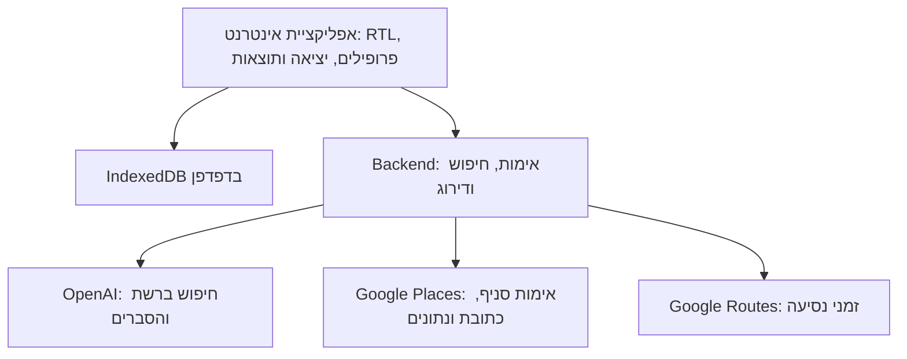

# ARCHITECTURE — אפליקציה לבחירת מסעדה לקבוצה

גרסה 0.3 · 24.10.2026 · מאושר · מבוסס על PRD גרסה 0.5.

המסמך מציע ארכיטקטורה אחת למימוש הדרישות המאושרות, בהיקף שמתאים לשימוש פרטי של משפחה וחברים קרובים. ערכים כגון תקרת זמן לבקשה וגודל מאגר מועמדים הם החלטות הנדסיות ראשוניות לכיול בבדיקות, ולא הבטחות ביצועים.

## 1. Technology Stack

| רכיב | טכנולוגיה נבחרת | תפקיד ונימוק |
|---|---|---|
| אפליקציה | React + TypeScript + Vite | אפליקציית אינטרנט אחת לכל הטלפונים, ללא התקנה מחנות. |
| התקנה למסך הבית | Web App Manifest + Service Worker (vite-plugin-pwa) | שמירה למסך הבית, פתיחה במסך מלא ופתיחת האפליקציה גם ללא רשת. |
| ניווט וממשק | React Router, CSS רגיל עם design tokens | ניווט ותצוגה בעברית; ללא ספריית UI נוספת. |
| נתונים במכשיר | IndexedDB באמצעות Dexie | פרופילים ומועדפים במסד מקומי בדפדפן, עם גרסאות מבנה (migrations). ללא הצפנה — המידע אינו רגיש. |
| יכולות הטלפון | Geolocation API, Web Share API, קישורים רגילים | מיקום רק לפי בחירת המשתמש, חלון השיתוף של הטלפון, פתיחת עמוד מסעדה. |
| פונט | Heebo, ארוז עם האפליקציה (@fontsource/heebo) | תצוגה זהה גם ללא רשת. |
| Backend | Node.js LTS + TypeScript + Express + Zod | תזמור חיפוש, אימות קלט ופלט, שילוב נתוני מסלולים ודירוג עקבי. מגיש גם את קובצי האפליקציה. |
| AI וחיפוש | OpenAI SDK, Responses API, web_search | חיפוש מקורות, ניתוח העדפות וניסוח הסברים. המודל נקבע בהגדרת שרת; מודל הפתיחה gpt-5.5, וזמינותו נבדקת ב־Milestone 4. |
| נתוני מקומות | Google Places API (New) | זיהוי סניף, פתרון כתובת ידנית, שעות פתיחה, דירוגים, אתר המסעדה וקישור חלופי כשאין אתר. |
| זמני נסיעה | Google Routes API — computeRouteMatrix | זמן נסיעה משוער ברכב מנקודת מוצא אחת למספר מסעדות. |
| הגנת API | מפתח גישה משותף + הגבלת קצב + מגבלות הוצאה אצל הספקים | מתאים לשימוש פרטי ללא חשבונות. |
| Hosting | Google Cloud Run + Secret Manager | שירות אחד שמגיש גם את האפליקציה וגם את ה־API, בכתובת HTTPS אחת. |
| בדיקות | Vitest; בדיקות API; בדיקות ידניות בטלפונים | בדיקות לחוקי דירוג, פרטיות וזרימות. |

### ביסוס הבחירה
אפליקציית אינטרנט שנשמרת למסך הבית נפתחת במסך מלא עם אייקון משלה, ב־iPhone וב־Android, בלי חנות ובלי חשבון מפתח בתשלום. כל היכולות שהמוצר צריך — מיקום, שיתוף, שמירה מקומית וקישורים — זמינות בדפדפנים האלה. [S1–S4]

תיעוד OpenAI מציג את Responses עם web_search כדרך לחיפוש מבוסס מקורות. gpt-5.5 הוא מודל פתיחה שמוגדר בהגדרת שרת; אם אינו זמין בחשבון, או אינו עומד ביעד הזמן, מחליפים אותו בהגדרה בלבד. האפליקציה משתמשת בחשבון API ולא במינוי ChatGPT. [S5–S6]

לא נדרשים מסד משתמשים בשרת, Firebase, אחסון קבצים, vector database או מנוע סוכנים נוסף.

### סיכונים ומגבלות
- החיפוש אינו סריקה מלאה של כל מסעדה או אתר בישראל; מקורות חסומים, מידע ישן או היעדר ביקורות עשויים להגביל את התוצאות.
- יעד הזמן (רוב החיפושים עד 60 שניות, תקרה 90) נקבע לפי מדידה ב־Milestone 4 (ADR-10); הוספת Places ו־Routes ב־Milestone 5 עלולה להאריך את הזמן, ונמדדת שוב.
- שעות פתיחה למועד עתידי אינן הבטחה לפתיחה בפועל, ובוודאי אינן זמינות שולחן.
- מפתח הגישה המשותף נמצא בתוך קוד האפליקציה ולכן אינו סוד מוחלט. הוא מספיק לשימוש פרטי; ההגנה העיקרית מפני עלות חריגה היא הגבלת קצב ומגבלות הוצאה אצל הספקים.
- **אחסון בדפדפן:** הנתונים נשמרים בדפדפן של הטלפון בלבד. מחיקת נתוני הדפדפן, הסרת האייקון מהמסך או החלפת טלפון מוחקות את הפרופילים והמועדפים. ב־iPhone, האפליקציה שנשמרה למסך הבית מחזיקה אחסון נפרד מלשונית Safari רגילה. האפליקציה מבקשת אחסון קבוע (navigator.storage.persist) כדי לצמצם מחיקה אוטומטית.
- מיקום ו־Service Worker פועלים רק בכתובת מאובטחת (HTTPS) או ב־localhost; זה משפיע על הבדיקה בטלפון בזמן הפיתוח (ראה 2.10).

## 2. System Architecture

### 2.1 מבנה והפרדת אחריות

**בדפדפן:** מודול Profiles מנהל פרופילים; Outing מנהל את המשתתפים, העדפות היציאה ומסלול החיפוש; Results מציג את ההסברים האישיים והקבוצתיים; Favorites שומר הפניות למסעדות; Share בונה פלט ציבורי נפרד. שכבת Repository מפרידה את IndexedDB מהממשק.

**בשרת:** AccessCheck → InputValidation → SearchOrchestrator → WebResearch → PlaceResolver → RouteEnrichment → MatchEvaluator → Ranker → ResponseValidator. ה־Ranker הוא קוד דטרמיניסטי; המודל אינו רשאי לשנות את סדר הקדימות שנקבע ב־PRD.

### 2.2 מודל נתונים במכשיר

| ישות | שדות עיקריים | משך שמירה |
|---|---|---|
| Person | id, displayName (ייחודי), foodTypes, foodText, diet, createdAt, updatedAt | IndexedDB, בין שימושים |
| Favorite | id, name, address, linkUrl, linkKind (official_site / alternative), optionalPlaceId, savedAt | IndexedDB, בין שימושים |
| Outing | selectedPersonIds, perPersonOverrides, searchMode, origin או areaIds, maxTravelMinutes, budgetRanges, kosher, atmospheres, visitAt | בזיכרון בזמן היציאה |
| SearchSession | opaqueParticipantMap, shownRestaurantIds, resultBatches, requestId | בזיכרון במהלך החיפוש והבקשות להמלצות נוספות |

אין ב־Person שדות לאלרגיות או לרגישויות. אין טבלת היסטוריית חיפושים. מחיקת Person מוחקת את הרשומה לצמיתות לאחר אישור המשתמש. ייחודיות השם נבדקת אחרי הסרת רווחים בקצוות.

מועדפים שומרים הפניה למסעדה, ואינם שומרים לצמיתות דירוגים, ביקורות או נתוני Google. פרטים עדכניים נשלפים שוב בעת הצורך; ללא רשת ניתן להציג את ההפניה השמורה בלבד. Place IDs מוחרגים ממגבלות caching של Places. [S8]

### 2.3 משמעות הקלט וקדימות

- **אוכל בפרופיל:** foodTypes (בחירה מרובה מקטלוג), foodText (עד 200 תווים), diet (vegetarian / vegan / indifferent). פרופיל ללא foodTypes נחשב indifferent לגבי סוג האוכל.
- **אוכל ליציאה:** מצב מפורש לכל משתתף — use_saved, specific או indifferent. דילוג = use_saved; ״לא משנה״ = indifferent. ב־specific חובה לפחות סוג אחד או טקסט; אחרת הלקוח חוסם המשך.
- **קדימות:** ב־specific, הבחירה לערב מחליפה את foodTypes של הפרופיל. foodText של הפרופיל נשלח תמיד, מסומן כעדיפות נמוכה; כשהוא סותר את הבחירה לערב, הבחירה לערב גוברת. diet נשלח תמיד ואינו מושפע ממצב היציאה.
- סוגים שנבחרו יחד הם חלופות רצויות, ולא דרישה שכולן יתקיימו בכל מסעדה.
- **תקציב:** budgetRanges הוא רשימה של אחד או יותר מתוך: upTo100 (0≤x≤100), 100to200 (100<x≤200), 200to300 (200<x≤300), 300to400 (300<x≤400), over400 (x>400); או indifferent, שהוא בלעדי. התאמה = המחיר המשוער לאדם נמצא באחד הטווחים. חומרת חריגה = המרחק לטווח הנבחר הקרוב. המחיר הוא הערכה עם מקור; אין להסיק סכום מדויק מסמל מחיר בלבד.
- **כשרות:** certified / at_least_no_pork_seafood / indifferent. מסעדה עם תעודה מתאימה גם ל־at_least_no_pork_seafood. האפשרות האמצעית מתארת מגבלת תפריט ואינה מוצגת כהוכחת כשרות.
- **אווירה:** atmospheres — אחת או שתיים מתוך romantic / family / lively / quiet / business, או indifferent (בלעדי). שתי אווירות הן חלופות. השרת דוחה יותר משתיים.
- **מועד:** visitAt — תאריך ושעת הביקור ב־Asia/Jerusalem, יחד עם ייצוג UTC.
- **searchMode=areas:** areaIds — אחד או יותר מקטלוג אזורים קבוע באפליקציה ובשרת. אין origin, אין זמן נסיעה ואין איסוף מיקום. האזורים מועברים למודל בשמם העברי; אין קריאה ל־Google לפתרון אזור.
- **searchMode=travel_time:** origin מהרשאת מיקום או כתובת ידנית; maxTravelMinutes אחד מ־15 / 30 / 45 / 60, מגבלת נהיגה ברכב.
- **מגבלות:** 1–10 משתתפים; כל טקסט חופשי עד 200 תווים.

**קטלוג אזורים ראשוני** (נתונים ניתנים לעדכון): גליל ועמקים, חיפה והקריות, חוף הכרמל וחדרה, שרון, תל אביב–יפו, גוש דן, שפלה, ירושלים והסביבה, באר שבע והנגב, אילת.

**קטלוג סוגי אוכל ראשוני** (נתונים ניתנים לעדכון): איטלקי, אסייתי, בשר, דגים, סושי, ים־תיכוני, ועוד לפי הצורך; הטקסט החופשי משלים.

### 2.4 זרימת חיפוש

1. האפליקציה יוצרת מזהים זמניים כגון p1 ו־p2 עבור המשתתפים ושומרת את המיפוי לשמות בזיכרון. נשלחות רק ההעדפות הדרושות לחיפוש. השמות אינם חלק מה־payload. אם המשתמש הקליד שם בתוך טקסט חופשי, הוא עלול להישלח; לכן הנוסח מבקש תיאור אוכל בלבד.
2. השרת בודק את מפתח הגישה, גודל הבקשה וה־schema. בקשה לא תקינה נדחית לפני חיוב שירותי חיפוש.
3. קריאת Responses אחת עם web_search מחפשת מועמדים בישראל ונתונים על תפריט, מחירים, כשרות, אווירה וביקורות. חיפוש ברשת מחויב בקריאה. reasoning effort נמוך ומספר קריאות חיפוש מוגבל, לטובת יעד הזמן. משמרים annotations ומקורות מקושרים. [S5]
4. מאגר של עד 10 מועמדים לבקשה (MAX_CANDIDATES, לכיול). בבקשת ״המלצות נוספות״ מוחרגות כל המסעדות שכבר הוצגו.
5. PlaceResolver מזהה סניף באמצעות שם, כתובת ו־Place ID, במקביל לכל המועמדים. הוא מביא שדות מוגבלים: שעות פתיחה, דירוג, מספר ביקורות, websiteUri ו־googleMapsUri. לא מערבבים בין סניפים בעלי אותו שם. פרטי Google נשמרים בנפרד מנתוני מחקר הרשת ואינם מועברים למודל. [S7–S8]
6. במסלול travel_time בלבד מופעל Routes ממוצא אחד למועמדים, במקביל ל־PlaceResolver ככל שהנתונים מאפשרים. שגיאה ליעד יחיד אינה פוסלת את כל הבקשה. אסור למודל להמציא זמן נסיעה. [S9]
7. מסעדה שידוע שהיא סגורה ב־visitAt מוסרת מהמאגר. MatchEvaluator קובע לכל פרמטר match / unknown / mismatch; Ranker ממיין ומחזיר עד חמש תוצאות. אין מילוי מלאכותי.
8. קישור לכל מסעדה: websiteUri כשקיים (linkKind=official_site); אחרת קישור חלופי — googleMapsUri או עמוד מקור מהמחקר שמתאר את המסעדה (linkKind=alternative); אחרת ללא קישור.
9. ההסברים נוצרים מהעדויות שמותר להעביר למודל ומאומתים מול שדות ההמלצה. אם הסבר סותר את העובדות או הדירוג, הוא מתוקן או מושמט ולא משנה את העובדות.
10. האפליקציה מחברת p1 לשם השמור ומציגה נימוקים אישיים. השיתוף נבנה מפלט ציבורי בלבד.

### 2.5 ביצועים ויעד הזמן

יעד: ברוב החיפושים תשובה מלאה תוך 60 שניות (עודכן מ־30 שניות ב־ADR-10). אמצעים: קריאת מודל אחת עם reasoning נמוך ותקרת קריאות חיפוש; עד 10 מועמדים; פורמט תשובה מקוצר; Places ו־Routes במקביל; שדות Places מינימליים. תקרת זמן קשיחה בשרת: 90 שניות (SEARCH_TIMEOUT_MS), שאחריה מוחזרת שגיאת SEARCH_TIMEOUT עם ניסיון חוזר. האפליקציה ממתינה עד 95 שניות.

ב־Milestone 4 נמדדים זמן ועלות על מדגם יציאות; הדוח (reports/milestone-4-search-times.md) מציג כמה חיפושים עמדו ביעד. אם רובם אינם עומדים בו — עוצרים ומציגים חלופות לפני המשך.

### 2.6 חישוב זמן נסיעה ומועד עתידי

Routes מחשב זמן נהיגה; מדובר באומדן מסלול. כתובת ידנית נפתרת ב־Places. לבקשת זמן נסיעה למועד עתידי משתמשים ב־departureTime כשהוא נתמך. [S9]

שעת היציאה שהמשתמש מזין היא שעת הביקור במסעדה. מכיוון שה־API אינו תומך ב־arrivalTime לנהיגה, זמן היציאה מוערך כשעת הביקור פחות maxTravelMinutes, בחישוב אחד לכל המועמדים, ומוצג ״זמן נסיעה משוער לקראת שעת הביקור״. אם המועד אינו נתמך או מסלול נכשל, מוצג ״לא ניתן לאמת זמן נסיעה״ והפרמטר מסומן unknown.

### 2.7 התאמה, חריגות ודירוגי רשת

לכל פרמטר פעיל נשמרים status: match / unknown / mismatch, מקור ו־reason. כלל הספירה:
- כל הגדרה קבוצתית פעילה היא פרמטר אחד: תקציב, כשרות, אווירה, אזור או זמן נסיעה.
- לכל משתתף: העדפת האוכל (סוגים + טקסט) היא פרמטר אחד, והעדפת התזונה — אם אינה indifferent — היא פרמטר נוסף.
- שעות פתיחה: סגורה = הסרה מהמאגר; לא ידוע = פרמטר unknown.
- מספר סוגי אוכל או אווירות שנבחרו לא ייצור עונש על כל חלופה שלא נמצאה.

סדר המיון:
1. **ללא חריגה ידועה (mismatchCount=0):** תחילה אלה שכל הפרמטרים שלהן אומתו, ואחריהן לפי unknownCount עולה.
2. רק אם נמצאו פחות מחמש כאלה: **התאמות חלקיות**, לפי mismatchCount עולה, ואחר כך unknownCount עולה.
3. באותם מספרים: התאמה רחבה יותר לכל המשתתפים וחומרת פער קטנה יותר, למשל חריגת תקציב קטנה לפני גדולה. דירוג ברשת אינו מעביר מסעדה עם שתי חריגות לפני אחת עם חריגה אחת.
4. בתוך קבוצת התאמה דומה: מוניטין ברשת. דירוגי Google משמשים מדד מספרי עקבי כשזמינים, תוך התחשבות במספר ביקורות; ביקורות ממקורות נוספים מוסיפות הקשר. אין להציג ממוצע גולמי של סקאלות מאתרים שונים. היעדר דירוג מסומן כחוסר מידע, לא כאפס.

לשקלול מספר ביקורות מאותו מקור מוצע Bayesian adjusted rating: משקל הדירוג תלוי במספר הביקורות מול prior של מאגר המועמדים. הפרמטר m נקבע בנתוני בדיקה ונשמר בקונפיגורציה. נוסחה זו אינה משנה את סדר ההתאמה.

תוצאת כשרות לא ידועה מסומנת ככזו. חריגה מאזור אפשרית רק להשלמת תוצאות, עם סימון מפורש; היקף ישראל לעולם אינו נחרג.

### 2.8 חוזה API

כל הבקשות נושאות כותרת X-App-Key עם מפתח הגישה המשותף.

**POST /v1/recommendations**

בקשה: requestId, participants עם token והעדפות בלבד, sharedFilters (budgetRanges, kosher, atmospheres), visitAt, searchMode, origin + maxTravelMinutes או areaIds, excludedRestaurantIds. session נשמר באפליקציה בלבד; בקשות נוספות הן עצמאיות.

תגובה: restaurants, fewerResultsReason, searchedAt, publicShareText, sources. לכל מסעדה: restaurantId, name, address, link {url, kind}, priceEstimate, optionalTravelEstimate, matchSummary, perParticipantReasons, groupReason, deviations, uncertainties, ratingsBySource. לכל עובדה נלווים מקור ומועד איסוף כשזמינים. publicShareText נבנה מרשימת שדות מותרת בשרת, ולא מטקסט הסברים אישיים. אין שדות תמונה.

חיפוש הוא בקשת HTTPS אחת, ללא queue. בהשלמה תוחזר JSON תקינה; לא מציגים JSON חלקית למשתמש.

**POST /v1/places/resolve** לפתרון כתובת ידנית בלבד. **POST /v1/favorites/refresh** מקבל הפניה למסעדה ומחזיר פרטים עדכניים ללא שמירת רשימת מועדפים בשרת.

שגיאות: UNAUTHORIZED, VALIDATION_ERROR, LOCATION_UNRESOLVED, PROVIDER_UNAVAILABLE, SEARCH_TIMEOUT, RATE_LIMITED. כולן מתורגמות להודעה עברית (ראה DESIGN) ולניסיון חוזר. כשל חיפוש מהותי אינו מוסווה כ״לא נמצאו מסעדות״. תקלה בשדה העשרה בודד יכולה להחזיר תוצאות עם סימון חוסר מידע.

האפליקציה חוסמת לחיצה כפולה תוך בקשה פעילה. ניסיון חוזר מפעיל חיפוש חדש בעלות נוספת.

### 2.9 פרטיות ואבטחה

- HTTPS בלבד בסביבה המותקנת. מפתחות OpenAI ו־Google ב־Secret Manager; אינם בקוד האפליקציה, במשתני VITE_ או ב־GitHub.
- מפתח הגישה המשותף (APP_ACCESS_KEY) נבדק בכל endpoint לפני כל קריאה בתשלום. ניתן להחליפו אם דלף.
- הגבלת קצב בזיכרון, ו־max instances=1 ב־Cloud Run כך שההגבלה חלה על כל השימוש. תקרת חיפושים ו־tokens לכל בקשה.
- **מגבלות הוצאה אצל הספקים:** מגבלת הוצאה חודשית בחשבון OpenAI, ומכסות יומיות + התראת תקציב ב־Google Cloud. מוגדרות בעת חיבור כל שירות (Milestone 4 ו־5), בהדרכה צעד אחר צעד.
- גוף הבקשה, כתובת מדויקת, העדפות והסברים אינם נרשמים בלוגים. שומרים מדדים תפעוליים בלבד: מזהה בקשה אקראי, זמן, קוד שגיאה ועלות משוערת.
- OpenAI נקרא עם store=false וללא Conversations, threads או background mode. אין בכך התחייבות ל־Zero Data Retention. [S11]
- ל־AI מועבר אזור מקורב לצורך חיפוש; המיקום המדויק נשלח ל־Google רק לצורך כתובת / מסלול. פלט השיתוף אינו כולל נקודת מוצא.
- אתרי רשת וטקסט חופשי נחשבים נתונים לא מהימנים. הוראות שמופיעות במקורות לא משנות את הוראות השרת; אין כלים לביצוע רכישה, הזמנה או שליחת הודעות. טקסט מהשרת מוצג כטקסט ולא כ־HTML.
- סכמות קלט מוגבלות וגודל טקסט תחום. אין fetch שרירותי לכתובות.

### 2.10 Hosting, Deployment, הפצה ו־Configuration

**מבנה הקוד:** Monorepo ב־GitHub: apps/web, apps/api, packages/contracts (חוזי API משותפים ב־TypeScript ו־Zod). apps/api ו־packages/contracts נוצרים ב־Milestone 3, כשנדרש לראשונה שרת. נועלים גרסאות יציבות באמצעות lockfile.

**פיתוח ובדיקה מקומית:**
- **במחשב:** האפליקציה נפתחת בדפדפן המחשב בכתובת localhost, בתצוגת טלפון (מצב מכשיר של Chrome). זו הבדיקה השוטפת; המיקום וההתקנה פועלים בה.
- **בטלפון:** כשצריך לבדוק על טלפון אמיתי, האפליקציה נחשפת זמנית בכתובת HTTPS באמצעות Cloudflare Quick Tunnel (כלי חינמי, ללא חשבון, שמותקן פעם אחת במחשב). הקישור פועל רק כל עוד ההרצה פעילה. בלי HTTPS, מיקום והתקנה למסך הבית לא יעבדו בטלפון.
- מ־Milestone 3 השרת רץ על המחשב, ושרת הפיתוח של Vite מעביר אליו את בקשות ה־API (proxy), כך שגם הטלפון ניגש לכתובת אחת.

**שרת מותקן:** שירות Cloud Run אחד עם Secret Manager, שמגיש את קובצי האפליקציה ואת ה־API באותה כתובת HTTPS. ללא סביבות נפרדות וללא CI אוטומטי. הפריסה ידנית, בהדרכה צעד אחר צעד, ב־Milestone 7. [S10]

**הפצה למשפחה וחברים:** שולחים קישור. ב־iPhone: פותחים ב־Safari ← שיתוף ← ״הוספה למסך הבית״. ב־Android: פותחים ב־Chrome ← ״התקנת האפליקציה״ / ״הוספה למסך הבית״. ללא חנויות וללא עלות התקנה.

**קונפיגורציית שרת:** OPENAI_API_KEY, OPENAI_MODEL=gpt-5.5, GOOGLE_MAPS_API_KEY, APP_ACCESS_KEY, SEARCH_TIMEOUT_MS=90000, MAX_CANDIDATES=10, MAX_OUTPUT_TOKENS, MAX_SEARCH_CALLS, SEARCH_CONTEXT_SIZE, PARALLEL_SEARCHES=1, RESEARCH_PROVIDER, RATE_LIMIT_PER_MINUTE.
**הגדרות האפליקציה:** VITE_APP_ACCESS_KEY (מפתח גישה משותף; אינו מפתח של ספק). כתובת ה־API יחסית, כי האפליקציה וה־API באותו שרת.

### 2.11 כיווניות, שפה והתקנה

- האפליקציה מוגדרת `<html lang="he" dir="rtl">`, וה־Manifest מוגדר `lang: he`, `dir: rtl` ו־`display: standalone`. התצוגה בעברית וב־RTL ללא תלות בשפת הטלפון. [S1]
- שימוש ב־safe areas (env(safe-area-inset-*)) כדי שהתוכן והניווט התחתון לא יוסתרו במסך מלא.
- Service Worker שומר את קובצי האפליקציה, כך שהיא נפתחת גם ללא רשת; חיפוש ורענון מועדפים דורשים רשת.
- כשהאפליקציה נפתחת בדפדפן ולא מהמסך הבית, מוצגת הנחיית התקנה (ראה DESIGN).

### 2.12 אימות הארכיטקטורה

- מסעדה ללא חריגה ידועה מדורגת לפני התאמה חלקית גם אם דירוג הרשת שלה נמוך יותר; חריגה אחת לפני שתיים; פרמטר לא ידוע אינו נספר כחריגה.
- העדפת יציאה גוברת על הפרופיל; ״לא משנה״ ודילוג מפיקים בקשות שונות; תזונה וטקסט הפרופיל נשלחים תמיד.
- מסלול areas עובד בלי הרשאת מיקום ובלי זמן נסיעה. מסלול travel_time משתמש בתוצאת API ולא בטקסט משוער של המודל.
- פרופילים ומועדפים שורדים סגירה ופתיחה של האפליקציה ושל הטלפון; שמות אינם מופיעים ב־payload ובלוגים.
- בדיקות לכשרות לא מאומתת, מסעדה סגורה במועד, שעות עתידיות, מסעדות עם שמות דומים, כפילויות והמלצות נוספות.
- בדיקה אוטומטית שפלט השיתוף אינו מכיל שמות, מזהים או הסברים אישיים.
- בדיקות RTL, עברית ומספרים ב־Safari ב־iPhone וב־Chrome ב־Android, במצב מותקן, כולל טלפון בשפה אנגלית, גודל טקסט מוגדל, טעינה וכישלון.
- מדידת זמן ועלות על מדגם יציאות בישראל מול יעד הזמן (רוב החיפושים עד 60 שניות, תקרה 90).

### מקורות רשמיים

נבדקו ב־24.10.2026; החלטות התכנון והפרמטרים המוצעים הם המלצות הנדסיות, בעוד המקורות מבססים יכולות ומגבלות של השירותים.

- [S1 — MDN: Web App Manifest](https://developer.mozilla.org/en-US/docs/Web/Progressive_web_apps/Manifest)
- [S2 — MDN: Web Share API](https://developer.mozilla.org/en-US/docs/Web/API/Web_Share_API)
- [S3 — MDN: Geolocation API](https://developer.mozilla.org/en-US/docs/Web/API/Geolocation_API)
- [S4 — MDN: Storage quotas and eviction](https://developer.mozilla.org/en-US/docs/Web/API/Storage_API/Storage_quotas_and_eviction_criteria)
- [S5 — OpenAI Web Search](https://developers.openai.com/api/docs/guides/tools-web-search)
- [S6 — GPT-5.5](https://developers.openai.com/api/docs/models/gpt-5.5)
- [S7 — Places data fields](https://developers.google.com/maps/documentation/places/web-service/data-fields)
- [S8 — Places policies](https://developers.google.com/maps/documentation/places/web-service/policies)
- [S9 — Routes matrix reference](https://developers.google.com/maps/documentation/routes/reference/rest/v2/TopLevel/computeRouteMatrix)
- [S10 — Cloud Run timeout](https://docs.cloud.google.com/run/docs/configuring/request-timeout)
- [S11 — OpenAI data controls](https://developers.openai.com/api/docs/guides/your-data)
- [S12 — Routes attribution](https://developers.google.com/maps/documentation/routes/policies)

## החלטות מרכזיות (ADRs)

### ADR-1: הפצה פרטית ופישוט ההגנות
**הקשר:** האפליקציה מיועדת למשפחה וחברים קרובים בלבד, ללא חנויות אפליקציות.
**החלטה:** ויתור על Firebase App Check, על סביבות staging / production נפרדות ועל CI אוטומטי. הגנה באמצעות מפתח גישה משותף, הגבלת קצב, max instances=1 ומגבלות הוצאה אצל הספקים.
**השלכות:** פחות חשבונות ופחות מורכבות. אם בעתיד האפליקציה תהיה ציבורית, יש להוסיף הגנה חזקה יותר ומכסות גלובליות.

### ADR-2: אפליקציית אינטרנט (PWA) במקום אפליקציית native
**הקשר:** התקנה פרטית של אפליקציית native על iPhone מחייבת חשבון Apple Developer בתשלום שנתי. המשתמש העדיף התקנה חינמית בשמירה למסך הבית.
**החלטה:** React + Vite כ־PWA, נתונים ב־IndexedDB ללא הצפנה, ושירות Cloud Run אחד שמגיש את האפליקציה ואת ה־API.
**השלכות:** אין עלות התקנה ואין חנויות; עדכון מגיע לכולם אוטומטית. הנתונים תלויים באחסון הדפדפן ועלולים להימחק עם נתוני הדפדפן, וב־iPhone הם נפרדים בין האפליקציה המותקנת ללשונית Safari. בדיקה בטלפון בזמן פיתוח דורשת כתובת HTTPS זמנית.

### ADR-3: יעד זמן של 30 שניות (הוחלף ב־ADR-10)
**הקשר:** ה־PRD קובע תוצאות תוך 30 שניות ברוב החיפושים.
**החלטה:** קריאת מודל אחת עם reasoning נמוך, עד 10 מועמדים, העשרה במקביל, ותקרה קשיחה של 55 שניות.
**השלכות:** ייתכן שהיעד לא יושג עם המודל הראשוני; המדידה ב־Milestone 4 קובעת אם להחליף מודל או לצמצם מועמדים.

### ADR-4: Monorepo עם npm workspaces והרצת בדיקה מ־build
**הקשר:** ב־Milestone 1 נוצר ה־Monorepo. נדרש כלי לניהול כמה חבילות (apps/web, ובהמשך apps/api ו־packages/contracts). בנוסף, ה־Service Worker של vite-plugin-pwa אינו פעיל בשרת הפיתוח של Vite, ולכן התקנה למסך הבית ומצב לא מקוון אינם נבדקים בו.
**החלטה:** npm workspaces (מובנה ב־npm) ללא כלי Monorepo נוסף; גרסאות מדויקות באמצעות `.npmrc` (save-exact) ו־`package-lock.json`. לבדיקת התקנה, מצב לא מקוון וקישור זמני לטלפון משתמשים ב־`npm run serve` (build + vite preview בפורט 4173); `npm run dev` נשאר לפיתוח שוטף. פונט Heebo נארז בתת־קבוצות עברית ולטינית בלבד, וה־Service Worker שומר מראש קובצי woff2 בלבד.
**השלכות:** אין תלות בכלי נוסף. כל שינוי בקוד דורש build מחדש כדי לראות אותו בהרצת הבדיקה. כש־apps/api ייווסף ב־Milestone 3, ה־proxy של Vite יוגדר גם ל־preview.

### ADR-5: ייצוג מועד הביקור וטיפוסי הבקשה עד Milestone 3
**הקשר:** ב־Milestone 2 נבנית בקשת החיפוש לפני שקיימים השרת ו־packages/contracts. מועד הביקור חייב להתפרש לפי שעון ישראל גם כשהטלפון מוגדר לאזור זמן אחר.
**החלטה:** visitAt נשמר כ־`{ local, timeZone: 'Asia/Jerusalem', utc }`; ההמרה ל־UTC ובדיקת ״מועד שעבר״ מחושבות עם Intl המובנה, ללא ספריית תאריכים. התאריך והשעה נבחרים בשני רכיבים מובנים של הדפדפן (date, time), והבדיקה נעשית גם בקוד כי Safari אינו אוכף `min`. טיפוסי הבקשה ו־`buildSearchRequest` נמצאים זמנית ב־apps/web (src/domain/searchRequest.ts), ומפת המזהים הזמניים (p1 → מזהה פרופיל) נשמרת בנפרד מהבקשה. אזורים, סוגי אוכל, תקציב ואווירה נשלחים כמזהי קטלוג.
**השלכות:** אין תלות חדשה. ב־Milestone 3 הטיפוסים עוברים ל־packages/contracts עם סכמת Zod, והתצוגה הזמנית של הבקשה במסך 04 מוסרת.

### ADR-6: חוזים משותפים ללא build, הרצת השרת עם tsx וקובץ הגדרות אחד
**הקשר:** ב־Milestone 3 נוספו apps/api ו־packages/contracts. האפליקציה והשרת צריכים אותן סכמות וקטלוגים, והשרת צריך לרוץ במחשב יחד עם שרת הפיתוח של האפליקציה.
**החלטה:** packages/contracts נצרך כקוד TypeScript ישירות (בלי שלב build): Vite מקמפל אותו באפליקציה, ו־`tsx` מריץ אותו בשרת (`tsx watch` בפיתוח). הקטלוגים (מזהים + תוויות עבריות) עברו ל־contracts, וקובצי הקטלוג באפליקציה מייצאים אותם מחדש. `npm run dev` ו־`npm run serve` בשורש מריצים את השרת (פורט 8787) ואת Vite במקביל באמצעות `concurrently`; Vite מעביר את `/v1/*` לשרת (proxy) גם ב־dev וגם ב־preview, ו־`/v1/*` מוחרג מה־Service Worker. קובץ `.env` אחד בשורש משמש את שניהם (Vite דרך `envDir`; השרת טוען אותו בהפעלה, ומשתנה שכבר קיים בסביבה גובר).
**השלכות:** אין תלות בכלי build נוסף לשרת עד הפריסה (Milestone 7, שם ייקבע אופן ההרצה ב־Cloud Run). `APP_ACCESS_KEY` ו־`VITE_APP_ACCESS_KEY` חייבים להיות זהים; בלי `APP_ACCESS_KEY` השרת אינו עולה.

### ADR-7: ממשק ספק מחקר ונתוני דוגמה בשרת
**הקשר:** Milestone 3 מדגים את כל הזרימה לפני חיבור OpenAI (Milestone 4), ונדרשת דרך לבדוק אפס תוצאות, כשל שירות, פלט שבור וחריגת זמן.
**החלטה:** ממשק `ResearchProvider` מחזיר **עובדות בלבד** על מועמדים (מטבח, מחיר, כשרות, אווירה, מנות צמחוניות/טבעוניות, שעות פתיחה, דירוגים לפי מקור, קישור, מקורות), והפלט נבדק מול סכמת Zod. ההחלטה match / unknown / mismatch (MatchEvaluator), הסינון לפי שעות פתיחה והדירוג (Ranker) נשארים בקוד דטרמיניסטי. ב־Milestone 3 הספק הוא ספק דוגמה עם כ־20 מסעדות בדויות (שמות שמתחילים ב״דוגמה:״, קישורים ל־example.com בלבד, זמני נסיעה קבועים לדוגמה), עם `dataSource: 'demo'`. `DEMO_SCENARIO` (normal / empty / provider_error / invalid_output / slow) מאפשר לראות כל מצב שגיאה בפיתוח. ההסברים נבנים בתבנית מתוך תוצאות ההערכה. דירוג הרשת לשבירת שוויון: Bayesian adjusted rating של מקור דירוג אחד עקבי (`primaryRating`), עם `RATING_PRIOR_WEIGHT` (ברירת מחדל 50).
**השלכות:** ב־Milestone 4 מחליפים רק את הספק ואת מחולל ההסברים; כללי ההתאמה והדירוג ובדיקותיהם נשארים. התאמת הטקסט החופשי בדוגמה היא חיפוש מילים בתפריט בלבד.

### ADR-8: תוספות לחוזה התשובה, כלל התקציב וטקסט השיתוף
**הקשר:** חוזה ה־API ב־2.8 מתאר את השדות העיקריים; המימוש הצריך כמה פרטים נוספים.
**החלטה:** לתשובה נוספו `dataSource` (demo / live), ולכל מסעדה `city` (לטקסט השיתוף), `parameters` (כל פרמטר פעיל עם status, reason ו־sourceIds; `deviations` ו־`uncertainties` הם תת־קבוצות שלו) ו־`travelEstimate` (במסלול זמן נסיעה בלבד). התאמת תקציב נקבעת לפי **אמצע** טווח המחיר המשוער; חומרת הפער היא המרחק בש״ח לטווח הקרוב. פלט ספק או תשובה שאינם עוברים אימות ממופים ל־PROVIDER_UNAVAILABLE (אין קוד שגיאה נפרד), בלי JSON חלקי. טקסט השיתוף נבנה בפונקציה אחת ב־contracts מרשימת שדות מותרת (שם, עיר, הסבר קבוצתי, קישור): השרת משתמש בה ל־`publicShareText`, והאפליקציה משתמשת בה כדי לבנות טקסט אחד לכל המסעדות שמוצגות (כולל ״המלצות נוספות״, במספור רציף). בנתוני דוגמה נוספת לטקסט שורה ״נתוני דוגמה — לא מסעדות אמיתיות״.
**השלכות:** הלב לשמירה במועדפים אינו מוצג בכרטיס עד Milestone 6. כל קישור בתשובה חייב להיות https.

### ADR-9: ספק OpenAI — עובדות עם מקורות שנבדקים בקוד
**הקשר:** ב־Milestone 4 ספק הדוגמה מוחלף בחיפוש אמיתי. המודל עלול להמציא מסעדה, קישור, מחיר או דירוג, ובקשת ״המלצות נוספות״ צריכה להחריג מסעדות שהמודל אינו מכיר לפי מזהה.
**החלטה:**
- קריאת Responses אחת: `web_search` עם `tool_choice: required`, `reasoning: low`, `store: false`, `max_tool_calls` (MAX_SEARCH_CALLS), `max_output_tokens`, `search_context_size` (SEARCH_CONTEXT_SIZE), `user_location` מקורב לישראל, ו־structured output קשיח (JSON schema מתוך Zod). ללא retries וללא Conversations / background. הספק נבחר ב־`RESEARCH_PROVIDER` (ברירת מחדל: openai כשיש `OPENAI_API_KEY`, אחרת demo).
- המודל מחזיר **עובדות בלבד**, ולכל עובדה (מטבח, מחיר, כשרות, אווירה, תזונה, שעות, דירוג) את כתובות העמודים שמבססים אותה. הקוד מקבל עובדה רק אם לפחות אחד מהעמודים שלה הוחזר בפועל מהחיפוש (`web_search_call.action.sources`, עמודים שנפתחו ו־citations). אחרת העובדה הופכת ל־null / unknown. מועמד בלי שום מקור מאומת, או בלי שם, עיר וכתובת — מושמט. תשובה בלי קריאת חיפוש שהושלמה נדחית (PROVIDER_UNAVAILABLE).
- `kosher: certified` רק עם מקור מאומת. אתר רשמי מסומן `official_site` רק אם הדומיין שלו הופיע בתוצאות החיפוש; אחרת הקישור הוא עמוד מקור של המסעדה (`alternative`).
- מזהים יציבים: `restaurantId` = hash של שם+עיר מנורמלים; `sourceId` = hash של ה־URL המנורמל — כדי שההחרגה ומיזוג המקורות יעבדו בין בקשות.
- לבקשה נוסף שדה אופציונלי `excludedRestaurantNames` (״שם — עיר״ של המסעדות שהוצגו, עד 100), שמועבר למודל; ההחרגה הקשיחה נשארת לפי `restaurantId`. מגבלת גוף הבקשה הועלתה ל־64KB.
- מיקום למודל: במסלול זמן נסיעה — קואורדינטות מעוגלות לשתי ספרות, או הכתובת הידנית בלי מספרים. זמני נסיעה אינם מחושבים עד Milestone 5 (`travelEstimate: null`, הפרמטר unknown).
- `primaryRating` לשבירת שוויון: אתר הדירוג שמכסה הכי הרבה מועמדים בבקשה (לפחות שניים), מנורמל ל־0–5. יוחלף בדירוג Google מ־Places ב־Milestone 5.
- הסברים: הסטטוסים והעובדות מהתבנית הדטרמיניסטית; מתווסף תיאור קצר של המודל, והערה אישית של המודל רק כשהקוד אישר התאמת אוכל לאותו משתתף. טקסט המודל מנוקה מ־HTML, קישורים, סימוני ציטוט ו־tokens.
- גוף הקלט נשלח כ־JSON בתוך `<outing_data>` (עם escape ל־< ו־>), עם הוראה להתעלם מהוראות שבתוכו ובאתרים.
- הלוג מקבל מדדים מספריים בלבד (זמן ספק, קריאות חיפוש, tokens, מועמדים) ושם המודל.
- פורמט התשובה מקוצר: כל מקור נכתב פעם אחת ברשימה ממוספרת והעובדות מפנות למספר; נשאלות רק שעות הפתיחה של יום הביקור והיום שלפניו (כל מה שבדיקת ״סגורה במועד״ צריכה).
- אפשר לפצל את החיפוש לכמה קריאות מקבילות (PARALLEL_SEARCHES), כל אחת מזווית אחרת, עם מיזוג והסרת כפילויות. ברירת המחדל היא קריאה אחת: במדידה שתי קריאות לא היו מהירות יותר.
**השלכות:** אמינות גבוהה יותר במחיר של מידע חסר (unknown) כשהמודל אינו מצטט את העמוד הנכון. הספק נבדק בבדיקות אוטומטיות עם לקוח מדומה. כללי ההתאמה והדירוג לא השתנו. הפרמטר `max_tool_calls` נתמך ב־API אך חסר בטיפוסי ה־SDK, ולכן מועבר בהמרת טיפוס.

### ADR-10: יעד זמן של 60 שניות ותקרה של 90
**הקשר:** במדידת Milestone 4 (gpt-5.5, חיפוש מחויב, עד 10 מועמדים) רק חיפוש אחד מתוך 11 הסתיים תוך 30 שניות; החציון היה כ־52 שניות והארוך ביותר 80. הזמן נקבע בעיקר על ידי החיפושים שהמודל מבצע ברצף ואורך התשובה. צמצום חיפושים ומועמדים כמעט לא קיצר, ופיצול לשתי קריאות מקבילות לא היה מהיר יותר. מודל מהיר יותר עלול לפגוע באיכות, והמשתמש העדיף איכות על פני מהירות.
**החלטה:** יעד חדש — ברוב החיפושים תשובה תוך 60 שניות; תקרה קשיחה בשרת 90 שניות (SEARCH_TIMEOUT_MS=90000); האפליקציה ממתינה עד 95 שניות. נשארים עם gpt-5.5, reasoning נמוך וקריאה אחת. ה־PRD עודכן בהתאם.
**השלכות:** ההמתנה ארוכה יותר; מסך הטעינה מציג פס התקדמות וספירה לאחור משוערת לפי היעד (60) והתקרה (90). ב־Cloud Run (Milestone 7) תקרת הבקשה צריכה להיות מעל 95 שניות (ברירת המחדל 300). הוספת Places ו־Routes ב־Milestone 5 נמדדת שוב מול היעד הזה.

