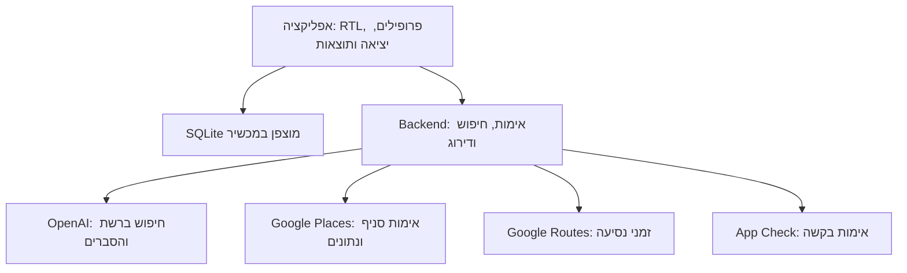

# ARCHITECTURE — אפליקציה לבחירת מסעדה לקבוצה

גרסה 0.1 · 23.10.2026 · טיוטה לאישור · מבוסס על PRD גרסה 0.3 שאושרה.

המסמך מציע ארכיטקטורה אחת למימוש הדרישות המאושרות. ערכים כגון תקרת זמן לבקשה וגודל מאגר מועמדים הם החלטות הנדסיות ראשוניות לכיול בבדיקות, ולא הבטחות ביצועים.

## 1. Technology Stack

| רכיב | טכנולוגיה נבחרת | תפקיד ונימוק |
|---|---|---|
| אפליקציה | React Native + Expo + TypeScript | קוד משותף שמפיק אפליקציות native ל־iOS ול־Android, ללא WebView כבסיס הממשק. |
| ניווט וממשק | Expo Router, React Native components, StyleSheet | ניווט ותצוגה בעברית; ללא מערכת UI נוספת בשלב הראשון. |
| נתונים במכשיר | expo-sqlite עם SQLCipher | פרופילים ומועדפים במסד מקומי מוצפן עם migrations. |
| מפתח מקומי | expo-secure-store | שמירת מפתח הצפנת המסד; אינו מחזיק מפתחות OpenAI או Google. |
| מיקום ושיתוף | expo-location; React Native Share ו־Linking | הרשאת מיקום בזמן שימוש בלבד, שיתוף טקסט וקישורים, פתיחת אתר מסעדה. |
| Backend | Node.js LTS + TypeScript + Express + Zod | תזמור חיפוש, אימות קלט ופלט, שילוב נתוני מסלולים ודירוג עקבי. |
| AI וחיפוש | OpenAI SDK, Responses API, gpt-5.5 עם web_search | חיפוש מקורות, ניתוח העדפות וניסוח הסברים. המודל ניתן להחלפה דרך הגדרת שרת. |
| נתוני מקומות | Google Places API (New) | זיהוי סניף וכתובת, מיקום, שעות פתיחה ודירוגים כאשר קיימים. |
| זמני נסיעה | Google Routes API — computeRouteMatrix | זמן נסיעה משוער ברכב מנקודת מוצא אחת למספר מסעדות. |
| הגנת API | Firebase App Check + React Native Firebase | אימות מקור האפליקציה ללא חשבון משתמש; אינו Firebase Authentication. |
| Hosting | Google Cloud Run + Secret Manager | שרת container מנוהל, סודות בצד השרת, מגבלות ריצה ותשתית. |
| מקור ובנייה | GitHub; Cloud Build; EAS Build / Submit | CI לשרת, builds לשתי הפלטפורמות והפצה לחנויות. |
| בדיקות | Jest; בדיקות API; Maestro | בדיקות משמעותיות לחוקי דירוג, פרטיות וזרימות במכשירים. |

### ביסוס הבחירה
Expo תומכת בבניית אפליקציות לשתי הפלטפורמות וב־RTL. SQLCipher דורש development build / production build; Expo Go אינו סביבת האימות למוצר זה. יש לוודא בפועל ש־cipher_version זמין לפני פתיחת נתונים. [S1–S4]

תיעוד OpenAI מציג את Responses עם web_search כדרך לחיפוש מבוסס מקורות, ו־gpt-5.5 תומך בכלי. זהו מודל פתיחה שמספיק להגדיר לבדיקות איכות; הבחירה אינה טענה שהוא הזול או המהיר ביותר. אין תלות במינוי ChatGPT האישי: האפליקציה משתמשת בחשבון API של המוצר. [S5–S6]

לא נדרשים מסד משתמשים בשרת, Supabase, Firebase Authentication, אחסון קבצים, vector database או מנוע סוכנים נוסף. App Check נדרש כדי להגן על פעולות API בתשלום גם ללא כניסה לחשבון. [S10–S11]

### סיכונים ומגבלות
- החיפוש אינו סריקה מלאה של כל מסעדה או אתר בישראל; מקורות חסומים, מידע ישן או היעדר ביקורות עשויים להגביל את התוצאות.
- זמן חיפוש ועלות תלויים במספר המקורות והמועמדים. אין הבטחה שחמש תוצאות מבוססות יימצאו בכל בקשה.
- חניה נמוכה / בינונית / גבוהה היא הערכה מהמידע הזמין, לא ספירת מקומות פנויים. אין להמיר עצם קיום חניון להבטחת זמינות גבוהה.
- שעות פתיחה למועד עתידי אינן הבטחה לפתיחה בפועל, ובוודאי אינן זמינות שולחן.
- App Check מצמצם שימוש לרעה אך אינו מחליף הגבלת קצב ותקציב. בלי חשבונות אין מכסה אישית אמינה לאדם מסוים.
- שמירה מקומית בלבד משמעה שאין שחזור מחשבון או סנכרון. הסרת האפליקציה או אובדן המכשיר עלולים לאבד את הפרופילים והמועדפים.
- דרושים חשבונות מפתח וחשבונות שירות בתשלום להפצה ולקריאות API; המסמך אינו מפעיל או רוכש אותם.

## 2. System Architecture

### 2.1 מבנה והפרדת אחריות

**במכשיר:** מודול Profiles מנהל פרופילים; Outing מנהל את המשתתפים, העדפות היציאה ומסלול החיפוש; Results מציג את ההסברים האישיים והקבוצתיים; Favorites שומר הפניות למסעדות; Share בונה פלט ציבורי נפרד. שכבת Repository מפרידה את SQLite מהממשק.

**בשרת:** InputValidation → SearchOrchestrator → WebResearch → PlaceResolver → RouteEnrichment → MatchEvaluator → Ranker → ResponseValidator. ה־Ranker הוא קוד דטרמיניסטי; המודל אינו רשאי לשנות את סדר הקדימות שנקבע ב־PRD.

### 2.2 מודל נתונים במכשיר

| ישות | שדות עיקריים | משך שמירה |
|---|---|---|
| Person | id, displayName, foodPreferences, dietPreferences, createdAt, updatedAt | מקומי בין שימושים |
| Favorite | id, officialNameFromWeb, canonicalRestaurantUrl, optionalPlaceId, savedAt | מקומי בין שימושים |
| Outing | selectedPersonIds, perPersonOverrides, searchMode, origin או areas, budget, kosher, parking, atmosphere, dateTime | בזיכרון בזמן היציאה |
| SearchSession | opaqueParticipantMap, shownRestaurantIds, currentResults, requestId | בזיכרון במהלך החיפוש והבקשות להמלצות נוספות |

אין ב־Person שדות לאלרגיות או לרגישויות. אין טבלת היסטוריית חיפושים. מועדפים שומרים הפניה למסעדה, ואינם שומרים לצמיתות דירוגים, ביקורות או נתוני Google. פרטים עדכניים נשלפים שוב בעת הצורך; ללא רשת ניתן להציג את ההפניה השמורה בלבד. הגבלות שמירה חלות על מקור הנתון, גם במכשיר. Place IDs מוחרגים ממגבלות caching של Places. [S8]

מפתח SQLCipher אקראי נשמר ב־SecureStore, עם הגדרת נגישות למכשיר בלבד כשנתמכת. קובצי הפרופילים והמועדפים יוחרגו מגיבוי ענן של מערכת ההפעלה בהתאם להחלטת ״במכשיר בלבד״. מפתח אינו נרשם בלוג. [S2–S3]

### 2.3 משמעות הקלט וקדימות

- לכל שדה העדפת אוכל יש מצב מפורש: use_saved, specific או indifferent. דילוג = use_saved; ״לא משנה״ = indifferent. אין להסיק את שניהם מערך ריק.
- ב־specific ניתן לבחור מספר סוגים ולהוסיף טקסט. סוגים שנבחרו יחד הם חלופות רצויות, ולא דרישה שכולן יתקיימו בכל מסעדה. המודל ינתח טקסט משלים יחד עם הבחירות ויציג אי־ודאות אם יש סתירה.
- תקציב, כשרות, חניה ואווירה הם שדות קבוצתיים; פרמטר indifferent אינו נשלח כדרישת התאמה.
- budget: טווחים בחצאי־קטעים ללא חפיפה לוגית, למשל 0≤x≤100, אחריו 100<x≤200. המחיר הוא הערכה לאדם, עם מקור; אין להסיק סכום מדויק מסמל מחיר בלבד.
- kosher: certified / no_certificate_no_pork_seafood / indifferent. האפשרות האמצעית מתארת מגבלת תפריט ואינה מוצגת כהוכחת כשרות.
- dateTime: תאריך ושעת הביקור ב־Asia/Jerusalem, יחד עם ייצוג UTC. תאריך ושעה משפיעים על שעות הפתיחה; אין טענה שניתן לחזות חניה פנויה.
- searchMode=areas: אין דרישה ל־origin או לזמן נסיעה, ואין איסוף מיקום במסלול זה.
- searchMode=travel_time: origin מגיע מהרשאת מיקום בזמן שימוש או כתובת ידנית; maxTravelMinutes הוא מגבלת נהיגה ברכב, בהתאם למונח ״נסיעה״ ב־PRD. זהו פירוש המימוש הראשוני; אין הוספת בורר אמצעי תחבורה.

### 2.4 זרימת חיפוש

1. המכשיר יוצר מזהים זמניים כגון p1 ו־p2 עבור המשתתפים ושומר את המיפוי לשמות בזיכרון. נשלחות רק ההעדפות הדרושות לחיפוש. השמות אינם חלק מה־payload. אם המשתמש הקליד שם בתוך טקסט חופשי, הוא עלול להישלח; לכן הנוסח מבקש תיאור אוכל בלבד, ואין להבטיח הסרת כל מידע מזהה מטקסט חופשי.
2. השרת מאמת App Check, גודל בקשה ו־schema. משולבים הפרופיל והעדפת היציאה לפי מצב הקלט. בקשה לא תקינה נדחית לפני חיוב שירותי חיפוש.
3. קריאת Responses עם gpt-5.5 ו־web_search מחפשת מועמדים בישראל ונתונים על תפריט, מחירים, כשרות, אווירה, חניה וביקורות. חיפוש ברשת מחויב בקריאה, ולא נשאר לשיקול tool_choice=auto. משמרים annotations ומקורות מקושרים. [S5]
4. מוגדר מאגר פתיחה של עד 15 מועמדים לבקשה, עם הרחבה תחומה אם אין חמש התאמות. זוהי תקרת תפעול ראשונית; אין טענה שנבדקו כל המסעדות האפשריות. בבקשת ״המלצות נוספות״ מוחרגות כל המסעדות שכבר הוצגו.
5. PlaceResolver מזהה סניף באמצעות שם, כתובת ו־Place ID. הוא מביא נתונים בשדות מוגבלים, לרבות שעות פתיחה, דירוג ומספר ביקורות כשהם קיימים. לא מערבבים בין סניפים בעלי אותו שם. פרטי Google נשמרים בנפרד מנתוני מחקר הרשת ואינם מועברים אוטומטית למודל. [S7–S8]
6. במסלול travel_time בלבד מופעל Routes ממוצא אחד למועמדים. שגיאה ליעד יחיד אינה פוסלת את כל הבקשה. אסור למודל להמציא זמן נסיעה. [S9]
7. MatchEvaluator משלב עובדות, מקורות ורמות ודאות; Ranker ממיין ומחזיר עד חמש תוצאות. אין מילוי מלאכותי כאשר הראיות אינן מספיקות.
8. הסברי המודל נוצרים מהעדויות שמותר להעביר אליו ומאומתים מול שדות ההמלצה. השרת מחבר אליהם נתוני Places / Routes והחריגות שחושבו בקוד. אם הסבר סותר את העובדות או הדירוג, הוא מתוקן או מושמט ולא משנה את העובדות.
9. המכשיר מחבר p1 לשם השמור ומציג נימוקים אישיים. השיתוף נבנה מפלט ציבורי בלבד.

### 2.5 חישוב זמן נסיעה ומועד עתידי

Routes מחשב זמן נהיגה; מדובר באומדן מסלול, ללא זמן חיפוש חניה. כתובת ידנית נפתרת ב־Places. לבקשת זמן נסיעה למועד עתידי משתמשים ב־departureTime כשהוא נתמך. [S9]

שעת היציאה שהמשתמש מזין היא שעת הביקור במסעדה. מכיוון שה־API אינו תומך ב־arrivalTime לנהיגה, המימוש יעריך זמן יציאה לכל מסעדה מתוך זמן המסלול, יחשב שוב פעם אחת סמוך לאותו זמן ויציג ״זמן נסיעה משוער לקראת שעת הביקור״. אין להשוות בטעות נסיעה שמתחילה בשעת הארוחה לנסיעה שמסתיימת בה. אם המועד אינו נתמך או מסלול נכשל, יוצג ״לא ניתן לאמת זמן נסיעה״ ולא התאמה מלאה לפרמטר זה. [S9]

### 2.6 התאמה, חריגות ודירוגי רשת

לכל פרמטר פעיל ולכל העדפה אישית נשמרים status: match / mismatch / unknown, מקור ו־reason. מספר סוגי אוכל שנבחרו לא ייצור עונש על כל חלופה שלא נמצאה. כל הגדרה קבוצתית היא פרמטר אחד, וכל שדה אוכל פעיל של משתתף הוא פרמטר אחד. זהו כלל ספירה הנדסי מפורש למימוש ״כמה שפחות פרמטרים מוחרגים״.

סדר המיון:
1. **התאמות מלאות מאומתות:** אין mismatch ואין unknown בפרמטרים הפעילים.
2. רק אם נמצאו פחות מחמש כאלה במסגרת החיפוש התחום: **התאמות חלקיות**, בסדר mismatchCount עולה. פרמטר לא מאומת אינו מסומן כמתאים; unknownCount מובא בחשבון יחד עם החריגות כדי שלא יקבל יתרון מלאכותי. התוצאה מסבירה בנפרד חריגה ידועה ומידע שלא אומת.
3. באותו מספר פערים: התאמה רחבה יותר לכל המשתתפים וחומרת פער קטנה יותר, למשל חריגת תקציב קטנה לפני גדולה. אין לאפשר לדירוג ברשת להעביר מסעדה עם שני פערים לפני אחת עם פער אחד.
4. בתוך קבוצת התאמה דומה: מוניטין ברשת. דירוגי Google משמשים מדד מספרי עקבי כשזמינים, תוך התחשבות במספר ביקורות; ביקורות ממקורות נוספים מוסיפות הקשר ועדכניות. אין להציג ממוצע גולמי של סקאלות מאתרים שונים. היעדר דירוג מסומן כחוסר מידע, לא כאפס.

לשקלול מספר ביקורות מאותו מקור מוצע Bayesian adjusted rating: משקל הדירוג תלוי במספר הביקורות מול prior של מאגר המועמדים. הפרמטר m ייקבע בנתוני בדיקה ויישמר בקונפיגורציה; אין למשתמש צורך להזין משקלים. אין לשנות את סדר ההתאמה באמצעות נוסחה זו.

״התאמה מלאה״ מתייחסת למידע שאומת בבקשה, לא להבטחה שהמסעדה תספק חוויה מסוימת. תוצאת כשרות או חניה לא ידועה מסומנת ככזו. חריגה מאזור אפשרית רק להשלמת תוצאות, עם סימון מפורש; היקף ישראל לעולם אינו נחרג.

### 2.7 חוזה API

**POST /v1/recommendations**

בקשה: requestId, participants עם token והעדפות בלבד, sharedFilters, visitAt, searchMode, origin או areas, excludedRestaurantIds. השדות origin ו־maxTravelMinutes אינם נדרשים במסלול areas. session נשמר במכשיר בלבד; בקשות נוספות הן עצמאיות.

תגובה: restaurants, fewerResultsReason, searchedAt, publicShareText, sources. לכל מסעדה: restaurantId, name, address, canonicalUrl, priceEstimate, parkingAssessment, optionalTravelEstimate, matchSummary, perParticipantReasons, groupReason, deviations, uncertainties, ratingsBySource. לכל עובדה נלווים מקור ומועד איסוף כשזמינים. publicShareText נבנה מרשימת שדות מותרת בשרת, ולא מטקסט הסברים אישיים.

אין GET jobs ואין queue בגרסה הראשונה. חיפוש הוא בקשת HTTPS אחת, עם timeout פנימי מוצע של 150 שניות ותקרת Cloud Run מעט גבוהה יותר. בהשלמה תוחזר JSON תקינה; לא מציגים JSON חלקית למשתמש. מצב הטעינה אינו דורש אחוזי התקדמות מומצאים. [S12]

**POST /v1/places/resolve** לפתרון כתובת או אזור בזמן חיפוש. **POST /v1/favorites/refresh** מקבל הפניה למסעדה ומחזיר פרטים עדכניים ללא שמירת רשימת מועדפים בשרת. לשניהם אותו אימות App Check.

שגיאות: VALIDATION_ERROR, LOCATION_UNRESOLVED, PROVIDER_UNAVAILABLE, SEARCH_TIMEOUT, RATE_LIMITED. כולן מתורגמות להודעה עברית ולניסיון חוזר לפי ה־PRD. כשל חיפוש מהותי אינו מוסווה כ״לא נמצאו מסעדות״. תקלה בשדה העשרה בודד יכולה להחזיר תוצאות עם סימון חוסר מידע.

המכשיר חוסם לחיצה כפולה תוך בקשה פעילה. לאחר ניתוק אין מנגנון שחזור job; ניסיון חוזר עשוי להפעיל חיפוש חדש בעלות נוספת. אין להבטיח exactly-once בין instances ללא אחסון משותף.

### 2.8 פרטיות ואבטחה

- HTTPS בלבד. API keys ב־Secret Manager; אין מפתח סודי בקוד האפליקציה, ב־EXPO_PUBLIC או ב־GitHub.
- App Check עם App Attest / DeviceCheck ב־iOS ו־Play Integrity ב־Android דרך החבילה הייעודית. טוקני debug מוגבלים לסביבת פיתוח. השרת מאמת באמצעות Admin SDK לפני קריאות בתשלום. [S10–S11]
- גוף הבקשה, כתובת מדויקת, העדפות והסברים אינם נרשמים בלוגים של היישום. שומרים מדדים תפעוליים בלבד: מזהה בקשה אקראי, זמן, קוד שגיאה ועלות משוערת.
- מקומיים בלבד: פרופילים ומועדפים. עיבוד זמני בשרת: העדפות הפעילות, מיקום נחוץ ותוצאות. אין DB של נתוני משתמש או היסטוריה בשרת.
- OpenAI נקרא עם store=false וללא Conversations, threads או background mode. אין בכך התחייבות ל־Zero Data Retention; מדיניות ניטור ושמירה של הספק נפרדת. [S13]
- ל־AI מועבר אזור מקורב לצורך חיפוש; המיקום המדויק נשלח ל־Google רק לצורך כתובת / מסלול. פלט השיתוף אינו כולל נקודת מוצא מדויקת.
- אתרי רשת וטקסט חופשי נחשבים נתונים לא מהימנים. הוראות שמופיעות במקורות לא משנות את הוראות השרת; אין כלים לביצוע רכישה, הזמנה או שליחת הודעות.
- מזהים וקישורים מאומתים בשרת; סכמות קלט מוגבלות וגודל טקסט תחום. אין fetch שרירותי לכתובות פנימיות. אם נדרשת שליפה ישירה, יש לחסום private IP ו־redirects לא בטוחים.
- rate limiting בזיכרון לכל instance, הגבלת concurrency ו־max instances, תקרת חיפושים / tokens לכל בקשה ומכסות ספק. הגבלה בזיכרון אינה מכסה גלובלית; אם שימוש ציבורי מחייב מכסות גלובליות, יש להוסיף אחסון תפעולי ייעודי לפני הרחבה, ללא שמירת פרופילים.

### 2.9 מקורות, ייחוס וזכויות שמירה

קישור למסעדה אינו מחליף מקור לטענות על מסעדה. מוצגים קישורי מקור לחיפוש מבוסס רשת באופן ברור וניתן ללחיצה. Google ratings / route estimates מוצגים עם ייחוס Google Maps ובנפרד מסיכום ה־AI, בהתאם להנחיות המקור. אין להעתיק ביקורות מלאות או תמונות לא מורשות. [S5, S8, S14]

מועדף שומר מזהה, שם וקישור שהתקבלו ממקור מותר לשמירה; תוכן Places אינו הופך למסד מקומי קבוע. נתוני API של Google לא מועברים למודל או משמשים לאימון כחלק מהמימוש הראשוני. לפני הפצה יש להשלים בדיקת התאמה של תצוגה, שיתוף ושמירה לתנאי ספקי הנתונים. [S8, S14]

### 2.10 Hosting, Deployment ו־Configuration

Monorepo ב־GitHub: apps/mobile, apps/api, packages/contracts. חוזי API משותפים ב־TypeScript ו־Zod. נועלים גרסאות יציבות תואמות בזמן פתיחת הפרויקט באמצעות lockfile; אין מסמך זה מניח מספר SDK שלא אומת.

השרת נבנה כ־container ל־Cloud Run. Cloud Build מחובר ל־GitHub לבדיקות ופריסה אוטומטית לסביבת staging; קידום production של גרסה שעברה בדיקות נעשה באופן מבוקר. סביבות נפרדות משתמשות במפתחות וב־Firebase apps נפרדים. Cloud Run נבחר לצורך התאמת timeout, ושליטה בריצה של בקשת חיפוש ארוכה. [S12, S15]

האפליקציה נבנית ב־EAS development builds וב־production builds ל־iOS ול־Android; הפצה ראשונה דרך TestFlight ו־Google Play testing, ולאחריה פרסום בחנויות. אין פריסה של frontend לאתר או ל־GitHub Pages. [S4]

קונפיגורציית שרת: OPENAI_API_KEY, OPENAI_MODEL=gpt-5.5, GOOGLE_MAPS_API_KEY, FIREBASE_PROJECT_ID, SEARCH_TIMEOUT_MS, MAX_CANDIDATES, MAX_OUTPUT_TOKENS, MAX_SEARCH_CALLS. הגדרות client ציבוריות: API_BASE_URL ומזהי אפליקציה בלבד. תקרות ראשוניות יכוילו לפי איכות, latency ועלות; תקציב התראות אינו נחשב חסימת חיוב אוטומטית.

### 2.11 אימות הארכיטקטורה לפני הפצה

- מקרה עם התאמה מלאה מדורג לפני התאמה חלקית גם אם דירוג הרשת שלו נמוך יותר; חריגה אחת לפני שתיים.
- העדפת יציאה גוברת על פרופיל; ״לא משנה״ ודילוג מפיקים בקשות שונות כנדרש.
- מסלול areas עובד בלי הרשאת מיקום ובלי זמן נסיעה. מסלול travel_time משתמש בתוצאת API ולא בטקסט משוער של המודל.
- פרופילים ומועדפים שורדים הפעלה מחדש; אינם מופיעים ב־payload, בלוגים או בגיבוי ענן בניגוד למדיניות.
- בדיקות לכשרות לא מאומתת, שעות עתידיות, מסעדות עם שמות דומים, כפילויות והמלצות נוספות.
- בדיקה אוטומטית שפלט השיתוף אינו מכיל שמות, מזהים או הסברים אישיים; המקורות והייחוס נשמרים ככל שנדרש.
- בדיקות RTL, עברית ומספרים במכשירי iOS ו־Android, כולל גודל טקסט מוגדל, טעינה וכישלון.
- מדידת עלות וזמן על אוסף יציאות מדגמי בישראל לפני קיבוע תקרות הייצור. אין בדיקות חיות או פריסה שבוצעו במסגרת מסמך זה.

### מקורות רשמיים

נבדקו ב־23.10.2026; החלטות התכנון והפרמטרים המוצעים הם המלצות הנדסיות, בעוד המקורות מבססים יכולות ומגבלות של השירותים.

- [S1 — Expo RTL](https://docs.expo.dev/guides/localization/)
- [S2 — Expo SQLite / SQLCipher](https://docs.expo.dev/versions/latest/sdk/sqlite/)
- [S3 — Expo SecureStore](https://docs.expo.dev/versions/latest/sdk/securestore/)
- [S4 — EAS Build](https://docs.expo.dev/build/introduction/)
- [S5 — OpenAI Web Search](https://developers.openai.com/api/docs/guides/tools-web-search)
- [S6 — GPT-5.5](https://developers.openai.com/api/docs/models/gpt-5.5)
- [S7 — Places data fields](https://developers.google.com/maps/documentation/places/web-service/data-fields)
- [S8 — Places policies](https://developers.google.com/maps/documentation/places/web-service/policies)
- [S9 — Routes matrix reference](https://developers.google.com/maps/documentation/routes/reference/rest/v2/TopLevel/computeRouteMatrix)
- [S10 — Firebase App Check backend verification](https://firebase.google.com/docs/app-check/custom-resource-backend)
- [S11 — React Native Firebase App Check](https://rnfirebase.io/app-check/usage)
- [S12 — Cloud Run timeout](https://docs.cloud.google.com/run/docs/configuring/request-timeout)
- [S13 — OpenAI data controls](https://developers.openai.com/api/docs/guides/your-data)
- [S14 — Routes attribution](https://developers.google.com/maps/documentation/routes/policies)
- [S15 — Cloud Run continuous deployment](https://docs.cloud.google.com/run/docs/continuous-deployment)
