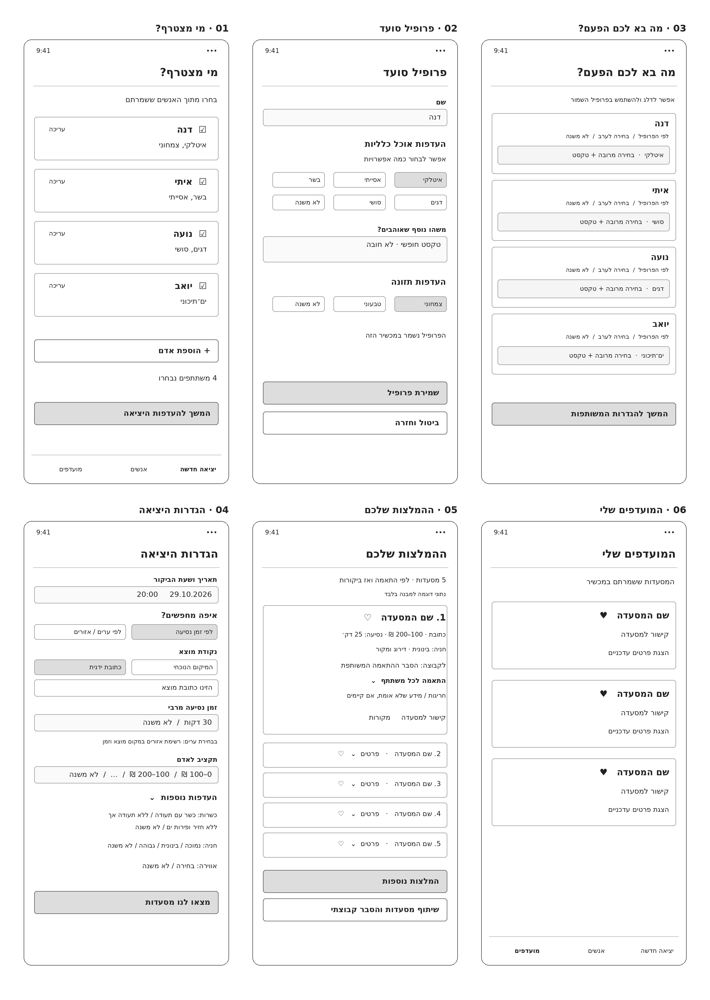
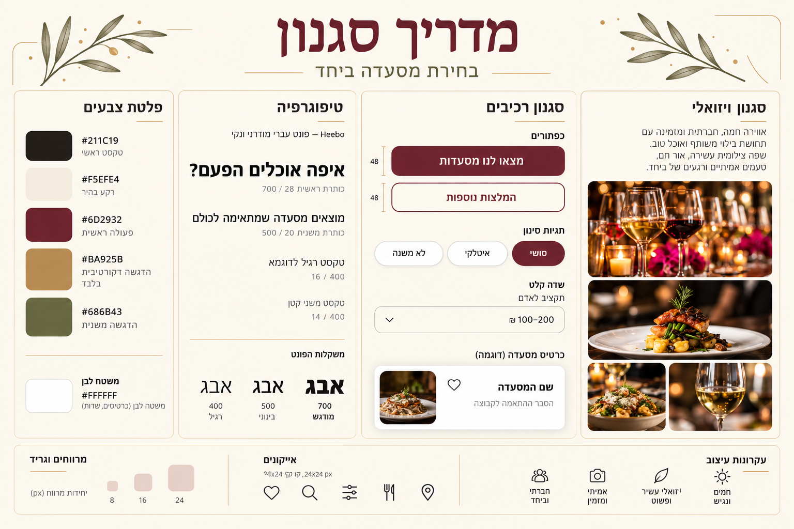
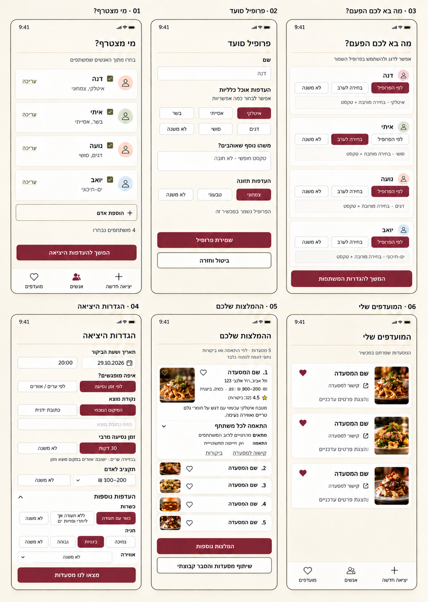

# DESIGN — אפליקציה לבחירת מסעדה לקבוצה

גרסה 0.3 · 24.10.2026 · מאושר

מבוסס על PRD 0.5, הארכיטקטורה, ה־Wireframes, ה־Style Guide וה־Mockups. מטרת המסמך היא להפוך את העיצוב המאושר להנחיות מימוש עקביות. אין כאן מסכים או יכולות נוספים.

ה־Mockups הם המחשה חזותית. נוסחים, מספרים והתנהגות מוגדרים במסמך זה וב־PRD; שיבושים בטקסט הקטן בתמונה אינם דרישות. תמונות האוכל ונתוני המסעדה בתמונות הם להמחשה ואינם המלצות אמיתיות. אין לקבע מחיר, ציון או זמן נסיעה מנתוני הדוגמה.

### עדכונים שגוברים על התמונות
התמונות נוצרו לפני ההחלטות של PRD 0.4–0.5. במקרים הבאים המסמך הזה גובר על ה־Wireframes וה־Mockups:
- **ניווט תחתון:** שני כפתורים בלבד — ״יציאה חדשה״ ו״מועדפים״. אין כפתור ״אנשים״.
- **חניה:** הוסרה לחלוטין — אין בורר חניה במסך 04 ואין שורת חניה בכרטיסי התוצאות.
- **תמונות מסעדות:** אין בגרסה הראשונה; כרטיסים במסכים 05 ו־06 הם כרטיסי טקסט.
- **מחיקת פרופיל:** כפתור ״מחיקת פרופיל״ במסך 02 במצב עריכה.
- **תקציב, אווירה, אזורים וזמן נסיעה:** תגיות בחירה (Chips) לפי סעיף 1.5, במקום הרשימות הנפתחות שבתמונות.

## 1. Screens

### 1.1 מפת המסכים

במוצר **שישה מסכים בלבד**, בהתאמה של 1:1 ל־Wireframes ול־Mockups:

| מספר | שם מדויק | מטרה | ניווט מרכזי |
|---|---|---|---|
| 01 | מי מצטרף? | בחירת הסועדים וניהול הפרופילים המקומיים | לפרופיל או להעדפות היציאה |
| 02 | פרופיל סועד | יצירה, עריכה ומחיקה של העדפות קבועות | שמירה, מחיקה או ביטול וחזרה |
| 03 | מה בא לכם הפעם? | העדפת אוכל אישית ליציאה הנוכחית | להגדרות המשותפות |
| 04 | הגדרות היציאה | מועד, מיקום והעדפות קבוצתיות | להפעלת חיפוש |
| 05 | ההמלצות שלכם | הצגת ההמלצות והנמקות | מקורות, שיתוף, מועדפים ועוד המלצות |
| 06 | המועדפים שלי | חזרה למסעדות שנשמרו במכשיר | קישור למסעדה ופרטים עדכניים |

טעינה, שגיאה, רשימה ריקה, פירוט נפתח, חלון אישור מחיקה, הנחיית התקנה, בחירת תאריך וחלון השיתוף של הטלפון הם מצבים או רכיבים בתוך הזרימה, ולא מסכים נוספים במפת המוצר.

**ניווט תחתון:** מופיע במסכים 01 ו־06. מימין ״יציאה חדשה״ (מסך 01), משמאל ״מועדפים״ (מסך 06). הכפתור של המסך הפעיל מודגש. ניהול האנשים נעשה במסך 01.

### 1.2 מסך 01 — מי מצטרף?

**מטרה:** בחירת משתתפים ליציאה, ללא הזנת העדפות מחדש, וגישה לניהול הפרופילים.

**מבנה ותוכן:** כותרת ״מי מצטרף?״; הסבר ״בחרו מתוך האנשים ששמרתם״; רשימת כרטיסים ובהם שם, תקציר העדפות, מצב בחירה וקישור ״עריכה״. סמל אדם מופשט הוא דקורטיבי בלבד; אין העלאת תמונת פרופיל. בהמשך כפתור ״הוספת אדם״, ספירת משתתפים וכפתור ״המשך להעדפות היציאה״.

**פעולות וניווט:** בחירה של כרטיס משנה את השתתפות האדם ביציאה בלבד. ״עריכה״ פותחת את מסך 02 עבור אותו אדם; ״הוספת אדם״ פותחת אותו מסך במצב יצירה. המשך פותח את מסך 03 עבור הנבחרים בלבד. ללא משתתפים כפתור ההמשך אינו פעיל, ובסמוך מוצג ״בחרו לפחות משתתף אחד״. ניסיון לבחור משתתף 11 אינו מתבצע, ומוצג ״אפשר לבחור עד 10 משתתפים״.

**מצב ריק:** ״עדיין לא הוספתם אנשים. הוסיפו את מי שיוצא איתכם.״, עם כפתור ההוספה הקיים. אין תהליך הרשמה.

**הנחיית התקנה:** כשהאפליקציה נפתחת בדפדפן ולא מהאייקון במסך הבית, מוצגת בראש מסך 01 רצועה קטנה שניתן לסגור: ב־iPhone — ״להתקנה: לחצו על כפתור השיתוף ב־Safari ובחרו ׳הוספה למסך הבית׳.״; ב־Android — ״להתקנה: פתחו את תפריט Chrome ובחרו ׳התקנת האפליקציה׳.״ לאחר סגירה היא אינה מוצגת שוב באותו דפדפן. במצב מותקן היא אינה מוצגת.

### 1.3 מסך 02 — פרופיל סועד

**מטרה:** שמירת העדפות כלליות לשימוש חוזר.

**מבנה ותוכן:** שדה ״שם״; כותרת ״העדפות אוכל כלליות״; הסבר ״אפשר לבחור כמה אפשרויות״; תגיות סוגי אוכל; שדה ״משהו נוסף שאוהבים?״ עם placeholder ״טקסט חופשי · לא חובה״ ומונה תווים (עד 200); העדפות תזונה; הודעה ״הפרופיל נשמר במכשיר הזה״; הכפתורים ״שמירת פרופיל״ ו־״ביטול וחזרה״. במצב עריכה בלבד, בתחתית המסך: ״מחיקת פרופיל״ — כפתור טקסט בצבע הפעולה הראשית, מופרד משאר הכפתורים.

תגיות הדוגמה ב־Wireframes הן איטלקי, אסייתי, בשר, דגים, סושי ו־״לא משנה״. רשימת התגיות ממומשת כנתוני קטלוג ניתנים לעדכון. טקסט חופשי משלים את הרשימה. בשדה תזונה מוצגות האפשרויות ״צמחוני״, ״טבעוני״ ו־״לא משנה״.

**התנהגות:** סוגי אוכל מאפשרים בחירה מרובה. ״לא משנה״ הוא מצב בלעדי שמנקה בחירות באותו שדה בלבד; בחירת סוג אוכל מוציאה ממצב זה. פרופיל בלי שום סוג אוכל נחשב ״לא משנה״. העדפת תזונה היא בחירה יחידה. אין איסוף מידע על אלרגיות או רגישויות.

**אימות ושמירה:** השם אינו יכול להיות ריק לאחר הסרת רווחים; אם הוא כבר קיים מוצג ״כבר יש פרופיל בשם הזה״. שאר ההעדפות אינן חובה. בשמירה מוצלחת חוזרים למסך 01; בעת כשל מוצגת הודעה בתוך המסך והערכים נשמרים לעריכה. ביטול אינו משנה את הפרופיל השמור.

**מחיקה:** לחיצה על ״מחיקת פרופיל״ פותחת חלון אישור: ״למחוק את הפרופיל של {שם}?״ עם ״מחיקה״ ו״ביטול״. לאחר מחיקה חוזרים למסך 01, והאדם מוסר גם מבחירת המשתתפים.

### 1.4 מסך 03 — מה בא לכם הפעם?

**מטרה:** לאפשר שינוי נקודתי לאותה יציאה עם שאלה אחת לכל משתתף.

**מבנה ותוכן:** כותרת המסך; הסבר ״אפשר לדלג ולהשתמש בפרופיל השמור״; כרטיס לכל משתתף שנבחר, לפי אותו סדר ממסך 01. בכל כרטיס שם ושלוש אפשרויות: ״לפי הפרופיל״, ״בחירה לערב״ ו־״לא משנה״. כפתור ההמשך: ״המשך להגדרות המשותפות״.

| מצב | מה מוצג בכרטיס | משמעות |
|---|---|---|
| לפי הפרופיל | תקציר העדפות שמורות לקריאה | שימוש בהעדפות הקבועות; זהו מצב הדילוג |
| בחירה לערב | בחירה מרובה של סוגי אוכל וטקסט משלים (עד 200 תווים) | העדפה נקודתית שקודמת לסוגי האוכל ולטקסט שבפרופיל |
| לא משנה | אישור שאין העדפת סוג אוכל ליציאה הזו | הסרת העדפת סוג האוכל מהחיפוש עבור המשתתף |

בכל המצבים, אם בפרופיל מוגדרת תזונה (צמחוני / טבעוני), מוצגת בכרטיס שורה קטנה לקריאה בלבד: ״תזונה: צמחוני״ — היא נשמרת תמיד.

**אימות:** במצב ״בחירה לערב״ בלי סוג אוכל ובלי טקסט, כפתור ההמשך אינו פעיל ובכרטיס מוצג ״בחרו לפחות סוג אוכל אחד או כתבו מה מתחשק״.

אין להציג תקציר פרופיל כשדה קלט פעיל במצב ״לפי הפרופיל״. הטקסט ״בחירה מרובה + טקסט״ בתמונת הדוגמה הוא סימון המחשה; במימוש הוא יוחלף ברכיבי הבחירה ובשדה הנפרדים בפועל. אין שמירת ההעדפה לערב בתוך הפרופיל.

**ניווט:** המשך פותח את מסך 04. חזרה באמצעות ניווט המערכת מחזירה לבחירת המשתתפים ושומרת את הקלט ביציאה הפעילה. הוספת משתתף אחר כך מוסיפה רק את הכרטיס שלו.

### 1.5 מסך 04 — הגדרות היציאה

**מטרה:** איסוף הגדרות פעם אחת עבור הקבוצה כולה.

**סדר התוכן:** תאריך ושעת הביקור; ״איפה מחפשים?״; שדות המיקום המתאימים למסלול; ״תקציב לאדם״; אזור מתקפל ״העדפות נוספות״ ובו כשרות ואווירה; כפתור ״מצאו לנו מסעדות״.

**תאריך ושעה:** רכיב בחירת התאריך והשעה המובנה של הדפדפן, כולל מועד עתידי. כותרת השדה ״תאריך ושעת הביקור״; דוגמה לתצוגה: 29.10.2026, 20:00. המועד משותף לכולם ומפורש לפי שעון ישראל. אין לאפשר מועד שעבר.

**בורר המסלול:** ״לפי זמן נסיעה״ או ״לפי ערים / אזורים״, בחירה יחידה.

| מסלול | שדות פעילים | שדות מוסתרים ואינם משפיעים על הבקשה |
|---|---|---|
| לפי זמן נסיעה | ״המיקום הנוכחי״ / ״כתובת ידנית״; ״זמן נסיעה מרבי״: תגיות 15 / 30 / 45 / 60 דקות, בחירה יחידה, ברירת מחדל 30 | אזורים |
| לפי ערים / אזורים | תגיות אזורים מהקטלוג (ARCHITECTURE 2.3), בחירה מרובה, לפחות אחד | נקודת מוצא וזמן נסיעה |

הרשאת מיקום מתבקשת רק לאחר בחירת ״המיקום הנוכחי״. בסירוב מוצג ״לא ניתן לקבל את המיקום. אפשר להזין כתובת או לחפש לפי ערים / אזורים.״ והאפשרויות הקיימות נשארות זמינות. אין לבקש מיקום עבור חיפוש אזורי. במסלול אזורים בלי אזור נבחר, כפתור החיפוש אינו פעיל ומוצג ״בחרו לפחות אזור אחד״.

**תקציב:** תגיות בחירה מרובה: ״עד 100 ₪״, ״100–200 ₪״, ״200–300 ₪״, ״300–400 ₪״, ״400 ₪ ומעלה״, ו־״לא משנה״ (בלעדי; ברירת מחדל). אין להשתמש בשיבושי מחיר או סימן מטבע מתמונת ה־Mockup.

**העדפות נוספות:** במצב הראשוני האזור מכווץ. ברירת המחדל של שני הפרמטרים היא ״לא משנה״.

- **כשרות:** ״כשר עם תעודה״, ״לפחות ללא חזיר ופירות ים״, ״לא משנה״; בחירה יחידה. התווית הארוכה נשברת לשורות בתוך הרכיב; אין לקצר ל־״כשר״.
- **אווירה:** תגיות לבחירה של עד שתיים: ״רומנטית״, ״משפחתית״, ״תוססת״, ״שקטה״, ״עסקית״, ו־״לא משנה״ (בלעדי). כשכבר נבחרו שתיים, שאר התגיות אינן פעילות ומוצג ״אפשר לבחור עד שתי אווירות״. אין להוסיף שדה נפרד לרמת רעש, ישיבה בחוץ או התאמה לילדים.

**פעולות:** הפעלת החיפוש שומרת את פרטי היציאה בזיכרון, חוסמת שליחה כפולה ומציגה טעינה באותו מסך: ״מחפשים מסעדות שיתאימו לכולם…״, ומתחתיו פס התקדמות וספירה לאחור (סעיף 2.3). בהצלחה עוברים למסך 05. בכישלון מוצגת הודעת השגיאה המתאימה (סעיף 1.8) וכפתור ״ניסיון חוזר״; אין איבוד של הקלט.

### 1.6 מסך 05 — ההמלצות שלכם

**מטרה:** להציג את אפשרויות הבחירה ואת הסיבות לדירוגן.

**מבנה:** כותרת ״ההמלצות שלכם״; מספר התוצאות בפועל והסבר קצר ״לפי התאמה לקבוצה, ואז דירוגים ברשת״; רשימת מסעדות ממוספרות; הכפתורים ״המלצות נוספות״ ו־״שיתוף מסעדות והסבר קבוצתי״.

כל כרטיס הוא כרטיס טקסט, ללא תמונה, וכולל:
- מיקום בדירוג, שם וסניף, כתובת ולב שמירה במועדפים אחד בלבד.
- טווח מחיר משוער לאדם, וזמן נסיעה משוער רק במסלול זמן נסיעה.
- דירוגים וביקורות עם שם המקור, סקאלת הציון ומספר הביקורות כשזמינים; אין להציג ציון התאמה כאילו הוא דירוג גולשים.
- ״התאמה לקבוצה״: הסבר קבוצתי קצר.
- ״התאמה לכל משתתף״: אזור נפתח עם שם כל משתתף וההסבר שלו, ללא מסך פרטים חדש.
- חריגות מפורשות ופרמטרים שלא אומתו, אם קיימים.
- קישור: ״לאתר המסעדה״ כשיש אתר רשמי; אחרת ״לפרטים על המסעדה״ לעמוד חלופי; אחרת ״לא נמצא קישור למסעדה״. וכן קישורי ״מקורות״.

הכרטיס הראשון פתוח כברירת מחדל, והאחרים מצומצמים. אפשר לפתוח כל אחד באותו מסך. כל הסבר נגיש בגלילה; אין לחתוך טקסט ללא דרך להציגו.

**סדר הדירוג:** מסעדות ללא חריגה ידועה תחילה. רק כשאין חמש, מוסיפים התאמות חלקיות, עם פחות פרמטרים חריגים לפני יותר. בין התאמות דומות משתמשים בדירוגים ובביקורות ברשת. כאשר אין חריגות ואין פרמטרים לא מאומתים מוצג ״ללא חריגות מההעדפות שנבחרו״. כאשר אין חריגות אך יש פרמטרים לא מאומתים מוצג ״ללא חריגות ידועות · {n} פרטים לא אומתו״. כאשר יש חריגה אין להסתירה.

**מידע חסר:** ״לא נמצא מידע מאומת״ מוצג ליד הפרמטר הרלוונטי. שעות פתיחה מתייחסות למועד הביקור ככל שניתן לאמת; אין נוסח שמבטיח שולחן פנוי.

**המלצות נוספות:** אותה בקשה עם אותם פרמטרים, ללא מסעדות שכבר הוצגו. התוצאות החדשות מתווספות מתחת לקודמות, תחת כותרת ״המלצות נוספות״, וממשיכות את המספור. טעינה ושגיאה מוצגות ליד הכפתור, והתוצאות הקודמות נשארות.

**שיתוף:** חלון השיתוף של הטלפון נפתח (Web Share). אם הדפדפן אינו תומך בשיתוף, הטקסט מועתק ומוצג ״הטקסט הועתק — אפשר להדביק אותו בכל אפליקציה״. הטקסט המשותף כולל את כל המסעדות שמוצגות כרגע, הקישורים וההסבר הקבוצתי בלבד. אין שמות, מזהים, הסברים אישיים או כתובת מוצא.

```
המלצות למסעדה ליציאה ב־29.10.2026, 20:00

1. {שם המסעדה} — {עיר}
{הסבר קבוצתי}
{קישור}

2. ...
```

**מצבים מיוחדים:** פחות מחמש תוצאות — ״נמצאו {n} מסעדות על בסיס המידע הזמין״; אפס תוצאות — ״לא נמצאו מסעדות שניתן להמליץ עליהן על בסיס המידע הזמין״; מיצוי אפשרויות נוספות — ״לא נמצאו מסעדות נוספות לפי ההגדרות האלה״. כשל שירות מוצג ככשל, ולא כתוצאת חיפוש ריקה.

### 1.7 מסך 06 — המועדפים שלי

**מטרה:** גישה חוזרת למסעדות ששמר המשתמש במכשיר.

**מבנה ותוכן:** כותרת ״המועדפים שלי״; הסבר ״המסעדות ששמרתם במכשיר״; כרטיסי טקסט עם שם, לב מלא, קישור (״לאתר המסעדה״ או ״לפרטים על המסעדה״) ו־״הצגת פרטים עדכניים״; ניווט תחתון זהה למסך 01.

**פעולות:** קישור פותח את העמוד השמור. ״הצגת פרטים עדכניים״ טוענת פרטים לתוך אותו כרטיס נפתח, ללא מסך חדש וללא דירוג מחדש. לחיצה על הלב המלא — כאן או במסך 05 — מסירה את המסעדה מהמועדפים מיד; במסך 06 הכרטיס נעלם, ובמסך 05 הלב חוזר להיות מתאר.

**מצבים:** רשימה ריקה — ״עוד לא שמרתם מסעדות במועדפים״. ללא רשת ההפניות השמורות נשארות גלויות; ליד הרענון מוצג ״נדרש חיבור לאינטרנט להצגת פרטים עדכניים״.

### 1.8 הודעות שגיאה

| קוד | הודעה |
|---|---|
| UNAUTHORIZED | ״האפליקציה אינה מורשית להתחבר לשרת. פנו למי שהתקין לכם אותה.״ |
| VALIDATION_ERROR | ״חלק מהפרטים אינם תקינים. בדקו את ההגדרות ונסו שוב.״ |
| LOCATION_UNRESOLVED | ״לא הצלחנו למצוא את הכתובת. נסו לנסח אותה אחרת או לחפש לפי ערים / אזורים.״ |
| PROVIDER_UNAVAILABLE | ״שירות החיפוש אינו זמין כרגע. נסו שוב בעוד רגע.״ |
| SEARCH_TIMEOUT | ״החיפוש לקח יותר מדי זמן. נסו שוב.״ |
| RATE_LIMITED | ״בוצעו הרבה חיפושים בזמן קצר. נסו שוב בעוד כמה דקות.״ |
| אין חיבור לרשת | ״אין חיבור לאינטרנט. התחברו ונסו שוב.״ |

כל הודעה מוצגת עם כפתור ״ניסיון חוזר״, למעט UNAUTHORIZED.

## 2. Style Guide

### 2.1 Color Palette

| Token | HEX | שימוש |
|---|---|---|
| text.primary | #211C19 | טקסט גוף וכותרות |
| background | #F5EFE4 | רקע הממשק |
| surface | #FFFFFF | כרטיסים ושדות |
| action.primary | #6D2932 | כפתור ראשי, בחירה פעילה ולב שמור |
| accent.decorative | #BA925B | קו דק או הדגשה דקורטיבית; לא טקסט גוף |
| accent.secondary | #686B43 | הדגשות משניות וסימוני בחירה |

הצבעים נלקחו מה־Style Guide שאושר. צבעי משנה לכיתוב ולקווים נגזרים מהפלטה בלי להחליש קריאות. בחירה ומידע חסר מזוהים גם באמצעות סימן וטקסט, ולא רק בצבע.

### 2.2 Typography

Heebo היא משפחת הפונט המיועדת למימוש, עם fallback מערכת שתומך בעברית. אין לשחזר את כותרת לוח ההשראה הדקורטיבית כפונט למסכי הטפסים.

| תפקיד | גודל בסיס | משקל | שימוש |
|---|---|---|---|
| כותרת מסך | 28 | 700 | שם המסך |
| כותרת אזור | 20 | 500–700 | העדפות, הגדרות וכרטיס ראשי |
| טקסט וכפתורים | 16 | 400 / 500 | קלט, גוף והסברים |
| טקסט משני | 14 | 400 | עזרה, מקורות ומידע משלים |

המידות הן יחידות לוגיות במכשיר. lineHeight של כ־1.4–1.5 לגוף. תמיכה בהגדלת טקסט; התוכן יגלול והרכיב יתרחב במקום להיחתך. כותרות ארוכות ותווית הכשרות יכולות להישבר לשורות.

### 2.3 UI Style

- כרטיסים לבנים עם radius של 12–16, גבול עדין וצל קל. בלי עומק דרמטי או קישוטים מאחורי טקסט.
- כפתור ראשי בורדו עם טקסט שמנת ממורכז. כפתור משני בהיר עם מסגרת בורדו. גובה יעד 48 לפחות; כפתור עם שתי שורות מתרחב בהתאם.
- שדות קלט בעלי תווית קבועה מחוץ לשדה; placeholder אינו מחליף תווית. מסגרת והדגשת focus ברורות.
- Chips ובוררים נבדלים ב־fill ובסימון בחירה. ״לא משנה״ נשאר זמין ולא נראה כמו שדה חסום. קבוצת Chips ארוכה נשברת לשורות.
- אייקונים קוויים בגודל חזותי 24, בתוך יעד לחיצה של לפחות 48. לב מלא = מסעדה שמורה; לב מתאר = טרם נשמרה.
- loading indicator לצד הטקסט המאושר, ומתחתיו פס התקדמות דק וספירה לאחור של זמן ההמתנה המשוער: ״נותרו כ־N שניות״ מ־60 שניות (יעד רוב החיפושים, ARCHITECTURE ADR-10). אחרי 60 שניות: ״לוקח יותר מהרגיל — עד N שניות נוספות״ עד תקרת 90 שניות, ואחריה ״עוד רגע…״. הפס מתמלא מימין לשמאל ואינו מגיע לסוף לפני שהתוצאות מגיעות; ללא אחוזים כתובים. אותה תצוגה גם ב״המלצות נוספות״. מצבי שגיאה מוצגים סמוך לפעולה שנכשלה.
- תאריך ושעה משתמשים ברכיב המובנה של הדפדפן; אישור מחיקה הוא חלון קטן בעיצוב האפליקציה. אלה אינם מסכי מוצר נוספים.

### 2.4 Visual Style

אווירה חמה ואלגנטית: שמנת, בורדו, קווים עדינים ומרחב נקי. אין להסיק מהמראה שההמלצות הן למסעדות יוקרה בלבד; הטווחים והעדפות המשתמש קובעים את התוצאות.

בגרסה הראשונה אין תמונות מסעדות; כרטיסי טקסט מלאים מחליפים אותן. אין להשתמש בצילומי ההשראה בתוך האפליקציה כאילו צולמו במסעדה שהומלצה. אין לוגו מלון או מיתוג מסעדה חיצונית כמותג האפליקציה.

### 2.5 Spacing / Layout

בסיס הריווח: 8, 16, 24. שוליים אופקיים של כ־20–24; padding כרטיס 16; מרווח בין כרטיסים 12–16. מסך 390×844 הוא קנה המידה להמחשה ולא גבול פיקסלים קשיח. נדרשת התאמה ל־Safari ב־iPhone ול־Chrome ב־Android, במצב מותקן (מסך מלא) ובדפדפן, כולל safe areas, מקלדת וגדלי פונט שונים.

טפסים ותוצאות גוללים אנכית; אין גלילה אופקית כדי לחשוף סוף תווית. הפעולה הראשית נשארת ניתנת לגישה אך אינה מכסה שדות או מקורות.

### 2.6 Language / Direction

כל הממשק בעברית וב־RTL אמיתי, גם כשהמכשיר מוגדר לשפה אחרת. שמות ותוויות מיושרים לימין; כפתורים ממורכזים. סדר הניווט, הבוררים והתגיות תואם RTL; מספרים, שעות, תאריכים, טווחי מחיר וכתובות אינטרנט נשמרים בסדר LTR מקומי בתוך הטקסט. אין להפוך תווי עברית ידנית. יש לבדוק גם שמות מעורבים בעברית ובאנגלית.

״בחירה לערב״ היא תווית המצב שאושרה; היא חלה על מועד היציאה שנבחר גם אם הוא אינו הערב הנוכחי. טקסט ההסבר משתמש במונח ״היציאה הזו״.

### 2.7 קבצים חזותיים מאושרים

ראה ״עדכונים שגוברים על התמונות״ בראש המסמך.

#### Wireframes



#### Style Guide



#### Mockups



### 2.8 קריטריוני התאמה לעיצוב

- קיימים בדיוק ששת המסכים במפה, ללא הוספת הרשמה, הזמנות או מידע שהוחרג; ניווט תחתון עם שני כפתורים.
- אין חניה ואין תמונות מסעדות בשום מסך.
- מסלול אזורים אינו דורש מיקום או זמן נסיעה; ההגדרות הנוספות ניתנות לצמצום.
- טקסט עברי, תוויות ארוכות, מספרים וטווחי מחיר מוצגים ללא חיתוך.
- ההסברים האישיים זמינים במכשיר; בשיתוף מופיע הסבר קבוצתי בלבד.
- כל פרמטר סינון משותף כולל ״לא משנה״ (למעט אזורים וזמן נסיעה); דילוג על העדפת אוכל נבדל מהסרת ההעדפה.
- דירוגים וזמני נסיעה אינם מוצגים כנתונים אמיתיים כאשר הם placeholders או אינם מאומתים.
- הכרטיסים מציגים חריגות ומידע חסר בבירור ואינם מסתירים אותם בצבע או בגודל טקסט קטן.
